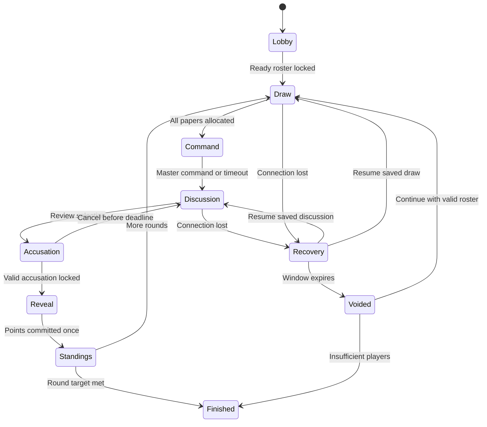
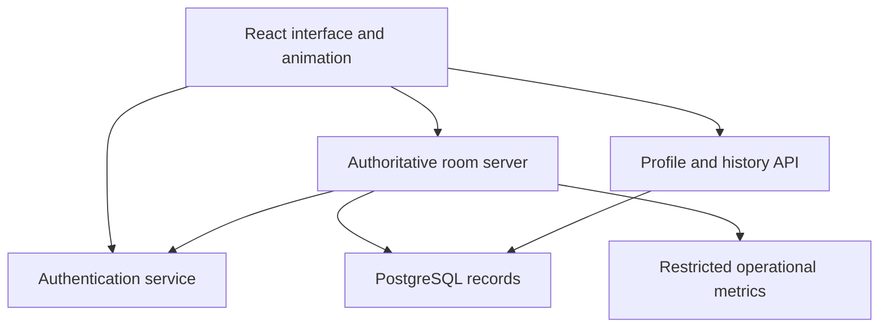

# KORO BABY
## Product and Development Planning Pack

**Version:** 0.1 · **Prepared:** 1 November 2026 · **Owner:** Hassan Barrie / NOMOLI FORGE

**Readiness:** Ready for a bounded interaction and technology prototype. Not a production specification approved for launch.

This document consolidates the visible planning conversation. It does not approve every generated mockup or claim player validation. Written rules below override contradictory text in concept images. No application has been built or tested as part of this planning deliverable.

## Contents

1. Product brief and success measures
2. Decision status and release scope
3. Rules and worked scoring
4. Match lifecycle and edge cases
5. Journeys and screen inventory
6. Design system direction
7. Architecture and trust boundaries
8. Records, privacy, and analytics
9. Quality targets and acceptance criteria
10. Delivery milestones
11. Playtesting, operations, and business
12. Decisions and risk register
13. First Codex task

## 1. Product brief and success measures

Koro Baby brings a remembered Sierra Leonean childhood paper game into a social browser experience. Players draw hidden papers, the Master commands the Police, suspects bluff, the Police accuses, and points accumulate over several rounds. The core promise is an enjoyable gathering that people want to repeat.

**Initial audience:** Sierra Leoneans who remember the game and invite friends; newer players learning it; diaspora groups connecting with people at home. This is a target audience hypothesis, not established demand.

**Two gathering types:** Together rooms support people speaking in the same physical location, each on their own device. Remote rooms support independent devices and in-game text discussion. Both initially require internet. Voice is a separate feasibility gate, not a launch promise. The game must remain usable without voice.

**Success evidence:** Track first-match completion, time to join, scoring comprehension, disconnection recovery, rematch requests, returning groups, reported enjoyment, and recurring service costs. Analyse Together and Remote separately. Do not treat long playing time alone as success.

## 2. Decision status and release scope

| Status | Meaning |
|---|---|
| Confirmed | Explicit user decision or directly described traditional rule |
| Working default | Recommended implementation starting point; adjustable after review |
| Experimental | Feature needs playtesting before general release |
| Deferred | Outside first-release commitment |
| Open gate | Must be resolved before the relevant milestone |

| Sector | Status and scope |
|---|---|
| Core roles/scoring | Confirmed: Master 100, Police 90, Koro Baby 0; highest match total wins |
| Variable paper count | Confirmed principle; descending-ten sequence is the working implementation |
| Responsive browser platform | Confirmed; phone-first with distinct desktop layouts |
| Authentication | Confirmed: sign-in required for live multiplayer; public tutorial is permitted |
| Private Together and Remote rooms | Confirmed direction |
| Player limit / match length | Working default: 4–10 players, 5 or 10 rounds |
| Classic mode | Foundation for the first release |
| Detective mode | Experimental beta; feature flag permits disabling it independently |
| Profiles and avatar builder | First-release scope; illustrated presets and modular customisation |
| Atmospheres | Selectable; one polished daylight courtyard plus an evening variation is the working scope |
| Historical avatars | Separate researched pilot; not a release blocker |
| Match history and analytics | Confirmed need; limited to defined purposes |
| Voice | Open feasibility and cost gate |
| Public matchmaking and ranked events | Deferred |
| Payments, shops, advertising, marketplace | Deferred |
| Personal photo uploads | Deferred |
| Offline / local-network play | Deferred research |

The earlier Detective-room and evening-investigation artwork is visual exploration. Atmosphere never silently changes rules. Build the second atmosphere from shared scene assets where practical; do not promise two entirely independent worlds.

## 3. Rules and worked scoring

### R01 — Papers

For N players, allocate one 100 paper, one 90 paper, one Koro Baby paper worth 0, and N−3 papers descending from 80 by ten. Four players therefore use 100, 90, 80, 0. Ten use 100, 90, 80, 70, 60, 50, 40, 30, 20, 0. Three-player play is unsupported because public roles would identify the remaining player.

Use server-side secure random shuffling. Each paper is allocated exactly once. Visual picking must map to unique pre-shuffled slots; concurrent picks cannot receive the same slot. Paper positions must not disclose values or persist a predictable mapping across rounds.

### R02 — Visibility and responsibilities

After allocation, announce Master and Police publicly. Other values remain private until a valid reveal. Players may verbally claim any number or bluff, but the application never exposes another suspect's paper before resolution. This visibility policy is a working digital rule requiring traditional-player review.

The Master issues the command. The Police makes one locked accusation against a suspect, excluding Master and Police. Host is an account-level room responsibility; Master changes with the draw. Neither avatar appearance nor purchased cosmetics affects roles.

### R03 — Awarded points

| Outcome | Police | Accused | Actual Koro Baby | Everyone else |
|---|---:|---:|---:|---|
| Correct | 90 | 0 | Same person as accused | Original paper value |
| Incorrect, accused held X | 0 | 90 | X | Original paper value |

Example with six players: Hassan 100, Mariama 90, Mohamed 80, Fatmata 70, Ibrahim 60, Aminata 0. If Mariama wrongly accuses Mohamed, award Hassan 100, Mariama 0, Mohamed 90, Fatmata 70, Ibrahim 60, Aminata 80. Total awarded remains 400. Five completed six-player rounds distribute 2,000 points in aggregate. Score animations present this calculation; they do not determine it.

Freshly shuffle each new round. Highest cumulative total wins after the selected number of completed rounds; casual ties share the winning position. Random draws mean points do not measure pure skill. No national ranking should compare raw totals across different table sizes or match lengths.

### R04 — Detective experiment

Starting tools: two structured questioning turns, optional opening statements, and one private pair clue per round in rooms of 6–10. The pair clue truthfully reports whether either selected suspect holds Koro Baby. It cannot target public roles or reuse its charge. For 4–5 players, omit the engine clue and retain social questioning.

No clue accuracy percentage or voice-based lie detection. One clue may still be powerful when combined with player information; evaluate that balance. Clue contents are private; a player may claim or misrepresent their clue in discussion. All players get identical tools when they draw Police.

Final defence is experimental: select a provisional suspect, allow a brief response, then confirm or change once before locking. Implement only after testing pacing; Classic does not require a compulsory defence stage.

## 4. Match lifecycle and edge cases

Diagram is abbreviated: recovery may occur at any unfinished stage and restores its saved stage and remaining time. A committed result is never voided by a later disconnect.

| Event | Working policy |
|---|---|
| Master idle | 10-second command window, then automatic command |
| Discussion | Host preset 45, 60, or 90 seconds; begin with 60 |
| Accusation deadline | 15-second final selection window after discussion |
| Police idle | Warn, then void round; do not randomly accuse |
| Paper not picked | 30-second draw deadline; auto-allocate an unclaimed paper to an active player |
| Disconnect | Pause unfinished round, reserve seat for 30 seconds; freeze deadline once, not on repeated reconnect loops |
| Reconnection succeeds | Restore same identity, paper, used tools and remaining time |
| Reconnection fails | Void unfinished round without points; explicit confirmation to continue or end |
| Roster change | New paper set next round; mark changed-roster match and exclude it from ordinary win statistics |
| Under four players | End as incomplete; preserve completed-round history |
| Host leaves | Transfer host deterministically to earliest remaining connected member |
| Removal in lobby | Host may remove players; blocked player cannot immediately rejoin with same account |
| Removal during match | Treat as roster-changing interruption; no normal result preserved for the unfinished round; record reason |
| Mid-match arrival | Wait outside active roster until next match; no secret state access |
| Refresh or double submit | Restore current state; no second paper, clue or score award |
| Server restarts | Recover committed state where supported; otherwise mark interrupted and void only the unfinished round |

Time values are proposed playtest defaults. Recovery logic must also cover a missing user during the accusation stage. A brief disconnect cannot extend the round indefinitely. Host abuse and deliberate quitting remain moderation concerns; private casual rooms are not yet ranked competition.

## 5. Journeys and screen inventory

**Invitation:** preview room → sign in/register → verify if needed → return to room → ready → match. If full, expired or already started, explain the state and offer a lobby wait or dashboard return. Preserve invitation context without trusting arbitrary redirect URLs.

**Host:** sign in → dashboard → create room → share invitation → review ready players → start → rematch or lobby.

**Identity:** create preset avatar → optionally choose district → save. District is affiliation, not GPS location. Use a verified district list; do not treat a city name as a district.

| ID | Screen | Essential behaviour |
|---|---|---|
| S01 | Welcome | Get started, sign in, public tutorial; no forced timed splash |
| S02 | Register | Labelled fields, password guidance, clear validation |
| S03 | Sign in | Recovery link and invitation continuity |
| S04 | Verify email | Link verification, resend cooldown, server-checked status |
| S05 | Recover password | Non-enumerating response |
| S06 | Reset password | Valid token, confirmation, success/expired states |
| S07 | Avatar builder | Illustrated presets, preview and save; no uploads |
| S08 | Dashboard | Create/join primary; tutorial and recent matches secondary |
| S09 | Create room | Gathering, rules, atmosphere, capacity and timing |
| S10 | Join room | Code entry, safe preview, capacity/error states |
| S11 | Lobby | Ready roster; settings changes clear readiness; host distinct from Master |
| S12 | Tutorial | Accurate roles and incorrect-accusation example |
| S13 | Draw | Unique selection, private open, waiting and timeout |
| S14 | Command | Master action; everyone else sees waiting status |
| S15 | Discussion | Stable players, chat and stage timer; Police-specific controls |
| S16 | Investigation | Private tool panel; separate pair and single-target selection |
| S17 | Confirm accusation | Named target, consequence, cancel/confirm |
| S18 | Private paper | Deliberate open/hide, optional privacy blur when tab loses focus |
| S19 | Round results | Accusation, role reveal, original-to-awarded values |
| S20 | Final results | All totals, ties, result eligibility, rematch |
| S21 | Profile | Illustrated identity and defined statistics |
| S22 | History | Completed, changed-roster, incomplete records distinguished |
| S23 | Settings | Sound, motion, lighter graphics, account, help/report |
| S24 | Reconnection | Deadline, reservation status, retry and leave |

Include supporting dialogs/states during implementation: sign-out, leaving a match, report/mute, account deletion, email verification success, invalid room, loading, empty history and service error. These do not require separate top-level navigation destinations.

## 6. Design system direction

Use illustrated Sierra Leonean everyday settings, tactile paper, warm ivory surfaces, indigo text, green actions and restrained amber accents. Cultural references need local review; generated pottery, clothing and architecture are not documentary evidence. Avoid generic ceremonial motifs used as decoration without context.

Use original illustrated avatars, never photo-like default portraits. Heritage characters require researched biographies and rights review. Personal photo uploads remain deferred. One avatar identity persists across screens; drawing a role does not replace its outfit or face.

Competitive design experiments suggest: social-table warmth for welcome and Together rooms; stable grid for player selection; conversation emphasis for Remote rooms. These are hypotheses, not approved usability findings. Make layout switchable without losing selected suspect, draft chat or timer.

React components should implement shared colour, type, spacing, radius, elevation and motion tokens. Material 3 Expressive is design guidance; community React packages are not official Google implementations. Evaluate before choosing. Keep library-specific components behind product wrappers. Avoid replacing cultural art with a generic Material theme.

Prototype ten-player layouts at 360×640 and 390×844 CSS pixels; test 320px reflow where feasible. Desktop uses table plus conversation side panel, not an enlarged phone screenshot. Ensure the software keyboard cannot cover send/confirm controls. Core action targets aim at least 48×48 CSS pixels. Use readable UI type, labels in addition to colour, visible focus, keyboard access, reduced motion, and text equivalents for sound.

Animations: selection emphasis; brief paper unfold; phase banner; private clue reveal; confirmed accusation; explicit score exchange. UI transition timings start around 150–300ms, with longer paper/reveal sequences kept short and skippable where appropriate. Do not let clients' animation duration control server deadlines. No animation implies hidden guilt.

## 7. Architecture and trust boundaries

**Proposed, not installed or benchmarked:** React + TypeScript; Vite build; CSS tokens and evaluated Expressive component foundation; Motion; Node.js + Colyseus for authoritative rooms; Supabase Auth; PostgreSQL for durable records. Phaser is optional and must justify its extra rendering layer. Voice is a separate provider/cost decision.

The server owns shuffled allocations, stage transitions, deadlines, clue budget, accusations and points. The client sends intentions, never trusted results. Verify authentication and room membership for every action. Database access policies and server checks must agree. No privileged database keys in browser bundles.

Only public state enters the shared room schema. Send private papers and clue results through verified per-client state views or targeted messages. Opponents' secrets must not appear in network payloads, HTML, analytics or client logs. Waiters cannot subscribe to hidden state.

Use match/round IDs, monotonic state versions and unique action IDs. A repeated action either returns its previous outcome or rejects safely. Award points and write result events transactionally with unique constraints. Persist allocation securely before revealing it privately. Save critical transitions; live room memory is not the database.

A reconnect receives a server snapshot, not a new draw. Derive countdown from server deadlines. If outcome persistence fails, do not display uncommitted final scores; show recovery. Reconcile event sequence on restart. Prototype single-instance operation first, with explicit restart limitations; scaling is a later measured decision.

Authentication requirements include email verification, password reset, rate limits, safe session storage and server token verification. Choose a single password policy during auth implementation; conflicting hints in generated screens are not requirements. Test token expiry, unverified accounts and expired invitations.

Hosting must support persistent multiplayer connections and a continuously running room process. Do not assume static hosting or short-lived serverless functions can host Colyseus. Determine frontend hosting, game-server region, database connection strategy, email delivery and costs before shared playtest deployment.

## 8. Records, privacy, and analytics

| Entity | Key records and purpose |
|---|---|
| Auth identity | Managed credentials, verification and session lifecycle |
| Profile | Account reference, unique username, display name, avatar config, optional district |
| Room / membership | Host, code, settings, seats and access status |
| Match / participants | Frozen initial roster, rules version, mode, settings, status and result eligibility |
| Round / allocations | Phase, deadlines, private assignment, void reason |
| Game events | Action ID, actor, type, version, timestamp; restricted sensitive fields |
| Results | Original/awarded points, totals, tie positions and commitment state |
| Feedback / reports | Issue category, relevant IDs, user comment, moderation status |
| Product metrics | Join/completion/rematch, errors and stage duration |

Public profiles do not expose email or exact location. Define personal history visibility separately from public statistics. Incomplete and changed-roster matches never silently count as ordinary wins.

Proposed retention for review before playtest: raw product events 30 days, technical logs 14 days, ordinary chat 7 days, aggregated metrics 12 months, match summaries while account is active, restricted detailed match evidence 90 days. Report evidence may need a separate documented retention period. These are working defaults, not legal determinations. Never record voice by default or collect contact lists and precise location.

Allow users to request deletion and explain what is removed or anonymised, including backups and report evidence. Retain no directly identifiable analytics beyond its purpose. Restrict administration by role and audit access to secret records. Child participation and applicable privacy/consent requirements are open launch gates, not settled by this document.

Event vocabulary: account_verified, room_join_attempt/result, match_started, round_completed/voided, accusation_locked, clue_used, reconnect_result, match_completed, rematch_requested, feedback_submitted. Use pseudonymous IDs and event definitions. Do not attach passwords, tokens, full chat or private allocations to product analytics. Report clue usage, not its secret contents.

## 9. Quality targets and acceptance criteria

Targets below are proposed evaluation gates, not measured performance claims.

| ID | Acceptance criterion / verification |
|---|---|
| AC01 | For every N from 4–10, exactly N unique papers and one of each special role |
| AC02 | Correct and incorrect accusations preserve total paper points; 6-player total is 400 |
| AC03 | Non-Police, wrong-phase, invalid-target and replayed commands cannot mutate outcome |
| AC04 | Two clients selecting the same paper cannot receive duplicate allocation |
| AC05 | Inspect suspect/waiter payloads: no opponent paper or private clue before reveal |
| AC06 | Refresh/reconnect preserves paper, budget, stage and committed scores |
| AC07 | Repeated requests and reconnect callbacks cannot award a round twice |
| AC08 | Expired/unverified sessions cannot join or act; invite destination survives sign-in safely |
| AC09 | Host departure, removal, roster change and timeout follow documented result eligibility |
| AC10 | Critical transaction failure does not produce a false completed result |
| AC11 | Ten player names, timer and available action remain usable on target phone sizes |
| AC12 | Keyboard operation, focus restoration, labels, contrast and reduced motion reviewed against WCAG 2.2 AA |
| AC13 | History matches server results and distinguishes incomplete records |
| AC14 | Account deletion and retention jobs verified with test accounts |
| AC15 | Detective clue targets/budget/visibility are enforced on server; no clue for 4–5 players |

Prototype performance targets: light-mode first usable screen within 5 seconds under a documented mid-range Android/1.5 Mbps test profile; total initial compressed transfer target ≤1.5 MB, with deferred scene assets; no multi-second UI blocking; action acknowledgement p95 ≤1 second at representative network conditions and 100 concurrent simulated users. Revisit using measured results; do not hide failures by changing targets without recording why.

Meaningful verification: unit tests for rules/state transitions; integration tests for auth, secret filtering, idempotency and persistence; browser tests for invitation-to-result; multi-client recovery tests; manual phone, keyboard and cultural review. Do not write tests that merely repeat component implementation.

## 10. Delivery milestones

| Milestone | Deliverable | Exit gate |
|---|---|---|
| M0 Planning baseline | This pack, open-decision register, selected references | Owner reviews working defaults; no unapproved build scope |
| M1 UI/technology trial | Expressive components, ten-player responsive discussion, chat and accusation flow with mock data | Target devices, focus, motion and library fit checked; choose implementation |
| M2 Local game engine | Pure rules/state machine and simulated complete matches | AC01–03 and scoring examples pass |
| M3 Authenticated multiplayer | Private rooms, verified accounts, secret state, chat, reconnect | AC04–09 plus multi-device test; deployed access requires auth |
| M4 Durable records | Results, history, restart handling, account controls | AC10, AC13–14; recovery demonstrated |
| M5 Content and Detective beta | Consistent illustrated assets, atmospheres, sound, optional beta tools | Local review, accessibility review, AC11–12/15 |
| M6 Closed playtest | Real Together and Remote sessions with feedback | Resolve critical errors and decide launch scope |
| M7 Release preparation | Operations, support, backups/restore, cost review and launch checklist | Explicit launch decision after evidence |

Persistence and identity should be designed early even if full history UI arrives at M4. Work locally with mock accounts only when clearly labelled; never deploy an unauthenticated multiplayer shortcut. Every milestone produces a reviewable preview, relevant evidence, documented limitations and a Git commit. Dates and cost ceilings remain unestimated until the trial and hosting choice.

## 11. Playtesting, operations, and business

Interview at least five people who remember the traditional game, including different groups where possible. Confirm commands, paper values, reveal behaviour and local rule differences. Do not claim one recalled variant is universal.

Proposed initial test: three Together groups and three Remote groups of 6–10, including beginners. Compare Classic then Detective, counterbalancing order when possible. Observe invitation completion, target selection, privacy understanding, score explanation, waiting time and desire to rematch. Aim for at least 80% of participants to explain wrong-accusation scoring afterward and most groups to finish without facilitator intervention; small-sample findings remain directional.

Assign responsibilities: Hassan owns product decisions and acceptance; development owns implementation and evidence; a named community contact owns reports; cultural reviewers assess context and representation. Before launch, name actual support/moderation owners and coverage rather than assuming automation handles abuse.

Free complete Classic play is the recommended foundation. Later revenue may include cosmetics, host-unlocked atmospheres, equal-access Detective experiences and sponsorship. No paid competitive clues. Business listings/advertising remain opt-in and separate from active rounds; game score is not seller reputation.

Potential cultural and employment outcomes must be measured through reviewed contributions and paid work, not asserted from download numbers. Government partnerships are optional opportunities, not required operating income.

Operating worksheet before M6: frontend delivery + room-server compute + database/storage/backups + email + monitoring + moderation/support + content production + optional voice. Estimate expected and high-use cases, then agree a monthly ceiling. Test restore procedures and establish an outage/recovery message.

## 12. Decisions and risk register

| Gate | Current recommendation | Resolve by |
|---|---|---|
| D01 Traditional variation | Validate this ruleset with remembered players | M2 |
| D02 Timeouts and departures | Adopt section 4 as trial defaults | M3 |
| D03 Expressive React package | Component trial; wrappers permit replacement | M1 |
| D04 Final art system | One avatar style/logo/type set; local review | M5 |
| D05 Voice | Text baseline; add only after reliability/cost test | M6 scope decision |
| D06 Hosting and budget | Persistent server plus database; select region/provider and ceiling | M3 deployment |
| D07 Age and privacy | Define audience eligibility, retention and consent requirements | Before external playtest |
| D08 Moderation ownership | Name responsible person and process | Before external playtest |
| D09 Detective balance | One limited clue, no ranked use yet | M6 |

Primary risks: confusing mockup copy; overpowered clues; luck mistaken for competitive skill; secret state leakage; deliberate quitting; weak mobile chat; expensive voice; oversized art; community-package churn; culturally generic imagery. Mitigate through written rules, server validation, small-device tests, limited scope and reviewed content. If Detective or voice fails its gate, release Classic/text scope rather than weakening the core game.

## 13. First Codex task

Build only M1 after repository setup is authorised. Use React/TypeScript and mock data. Evaluate a Material 3 Expressive implementation against form, selection, dialog and reduced-motion needs. Produce a responsive ten-player discussion prototype with stable roster, public Master/Police, private-paper view, text-chat panel and accusation confirmation. Support Together and Remote layout emphasis. Do not add backend services, payments, public rankings or personal image uploads in this task.

Acceptance: works at 360×640, 390×844 and desktop widths; keyboard and touch selection; modal focus restores correctly; opening chat preserves selected suspect; viewing own paper reveals no other values; demo labels clearly identify simulated state. Report library limitations, payload size and tested browsers. Commit only reviewed work; no public launch in this milestone.

### Technical reference starting points

These links support future implementation review; package versions and compatibility must be rechecked at M1.

- React: https://react.dev/
- Material design guidance: https://m3.material.io/
- MUI overview (not an official Expressive implementation): https://mui.com/material-ui/getting-started/
- Community Expressive candidate: https://m3e.language-lit.com/
- Motion: https://motion.dev/docs/react
- Colyseus: https://docs.colyseus.io/
- Supabase Auth: https://supabase.com/docs/guides/auth
- Phaser templates: https://phaser.io/oss/docs/phaser/getting-started/project-templates
- Accessibility standard: https://www.w3.org/TR/WCAG22/
- Relevant mobile design case study: https://www.jordankolb.com/proavalon-case-study

**Next review:** inspect working defaults and M1 scope, then begin the bounded prototype. Changes to rules, scope or retention must update this pack's version and decision register.

## 14. Dribbble research and screen refinement — 2 November 2026

This addendum consolidates the later UI discussion. Recommendations are prototype hypotheses, not tested usability results. Existing written rules override concept artwork. The existing filename is retained for repository compatibility.

### Reference catalogue
- Abdur Rouf, Online Game Lobby: https://dribbble.com/shots/26321588-Online-Game-Lobby-Design — described presence, readiness, communication and board-material variations; full interactive artwork not inspected.
- Nixtio, Avatar Personalization: https://dribbble.com/shots/27397182-Mobile-Gaming-UI-for-Avatar-Personalization — described customisation, layered environments and motion; not independently tested.
- tubik, Avatar Customization Flow: https://dribbble.com/shots/27240788-Avatar-Customization-Flow-for-a-Gamified-App — described modular appearance and clothing; do not import its reward system.
- Michal Sambora, Game Login: https://dribbble.com/shots/2358349-Daily-Shmaily-UI-1-Game-Login — static artwork inspected; experimental layout, not a usability benchmark.
- Ekta Sarangi, Tutorial Screens: https://dribbble.com/shots/14156091-Tutorial-Screens-for-Game-App — published description; interaction not verified.
- Majidur Rahman, Card Game UI/UX: https://dribbble.com/shots/26184620-Card-Game-UI-UX-Intuitive-Gameplay-Engaging-Interactions — static artwork inspected; full animation not verified.
- Martina Ferreira, FIFA Pro Clubs Redesign: https://dribbble.com/shots/21642842-FIFA-Pro-Clubs-Rankings-Redesign — static artwork and written rationale for history, filtering and on-demand detail.
- Rita, Game Settings: https://dribbble.com/shots/8398387-Game-Settings — static design exercise inspected.

Adapt general patterns, not copied artwork. Portfolio popularity is not usability evidence. No close game-specific verification/reconnection reference was established; use straightforward functional web patterns.

### All-screen recommendations
| ID | Screen | Refinement |
|---|---|---|
| S01 | Welcome | One gathering illustration; entry actions visible early; no forced splash. |
| S02 | Register | Compact labelled form, consistent password guidance and inline errors. |
| S03 | Sign in | Match registration; preserve invite destination and recovery link. |
| S04 | Verify | Show destination and resend cooldown; verify status on server. |
| S05 | Recover | One email field; neutral confirmation replaces form. |
| S06 | Reset | Consistent password rules; expired-link and success states. |
| S07 | Avatar | Large illustrated preview, category grid, reachable Save; animate changed feature. |
| S08 | Dashboard | Create/Join dominant; tutorial and history secondary. |
| S09 | Create room | Group gathering, rules, atmosphere and timing; live summary. |
| S10 | Join | Code entry then preview; full, started and expired states. |
| S11 | Lobby | Code/invite prominent; stable readiness grid; distinguish Host/Ready/Connected. |
| S12 | Tutorial | Short steps, practice interaction and correct scoring example. |
| S13 | Draw | Identical folded papers; select/confirm/unfold; clear availability. |
| S14 | Command | Master action plus waiting view; short shared phase banner. |
| S15 | Discussion | Stable ten-player roster; Together table emphasis, Remote chat emphasis. |
| S16 | Investigate | Separate questioning and pair selection; private clue and remaining budget. |
| S17 | Accusation | Named target, consequence, cancel/confirm and focus restoration. |
| S18 | Private paper | Only own paper; quiet overlay, immediate hide, reduced-motion option. |
| S19 | Round result | Accusation explanation then original-to-awarded points. |
| S20 | Final | Brief celebration, complete standings, ties and incomplete status. |
| S21 | Profile | Consistent illustrated identity, optional district, defined statistics. |
| S22 | History | Compact status/date/mode records and expandable details. |
| S23 | Settings | Sound/Display/Account/Privacy/Support groups; deletion separate. |
| S24 | Reconnect | Reservation, pause, deadline, expiry consequence, retry and leave. |

### Shared interface requirements
Use rich illustration on welcome and celebration, quiet surfaces on forms/history/settings, and maximum clarity during rounds. Reduce scenery before reducing readable labels or touch targets.

Outside matches: Play / History / Profile, with Settings in the header. Inside matches: contextual paper/discussion/player actions; no unrelated global navigation. Generated mockups' changing navigation is not approved.

Player positions remain fixed throughout a round. Selection, speaking, public role and connection are card states. Local suspect selection stays private until an explicit game action announces it. Preserve avatar face/hair/outfit across screens; roles are separate badges, not forced costumes.

Mobile uses compact roster and expandable panels; desktop uses table plus chat side panel. Switching layouts preserves suspect, draft message and stage. Test ten players, long names, software keyboard and reconnection.

Build six reusable patterns: FormCard, PlayerCard, RoomSummary, OverlayPanel, ResultRow, ActionBar. Implement only those needed in M1 initially. Define one logo, typography scale, icon family and shared tokens.

Material 3 Expressive informs shape/hierarchy/feedback. Sierra Leonean reviewed art, language and paper ritual establish identity.

### Motion and correctness
Paper unfold, selection outline/checkmark, command banner, private clue reveal, accusation lock, score exchange and short celebration each communicate state. Reduced motion preserves information. No animation implies guilt.
- 80 → 90 is +10, never +80.
- Pre-draw copy: “Roles appear after the draw”, not “No secret roles in this game”.
- Selecting another player opens public details, never their private paper.
- Only confirmed server outcomes drive production result animation.

## 15. Work-tab / Codex handoff

Attach this file or commit it as docs/planning/Koro_Baby_Planning_Pack_v0.1.md. Add selected illustrated reference images to docs/design/references/ with notes on known mockup errors. Another work tab should not be assumed to inherit this conversation or access Library links.

Task 01 is M1 only: React/TypeScript/Vite, an evaluated Expressive foundation, mock ten-player discussion (Mariama Police90, Hassan Master100), Together/Remote presentation, own-paper panel, local demo chat, suspect selection and confirmation. Label simulated players/timer. A confirmation produces local acknowledgement/reset, not invented match results.

Preserve selected suspect/chat draft when panels switch. Verify phone/desktop, touch/keyboard, dialog focus/reduced motion, type checking, lint, build and meaningful interaction tests. Capture representative screenshots and report actual checks and limits. Evaluate dependencies against current documentation during implementation.

No backend, authentication implementation, database, voice, payments, uploads, public rankings or full 24-screen build in Task 01. Simulated identity is allowed only in the labelled prototype; live multiplayer later requires authentication. Do not deploy publicly, commit or push until separately instructed. Read repository instructions and preserve unrelated work.

Planning and UI recommendations are consolidated for M1. Component choice, final art, hosting and launch gates remain open.
